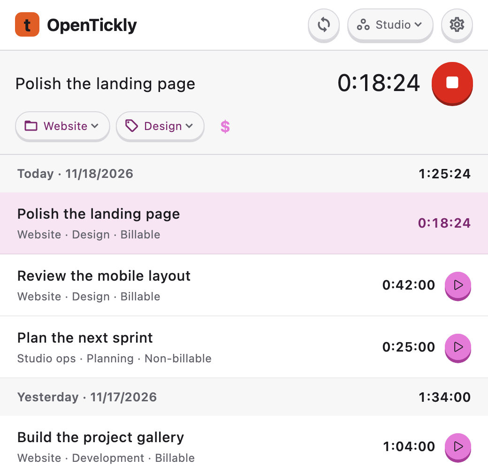
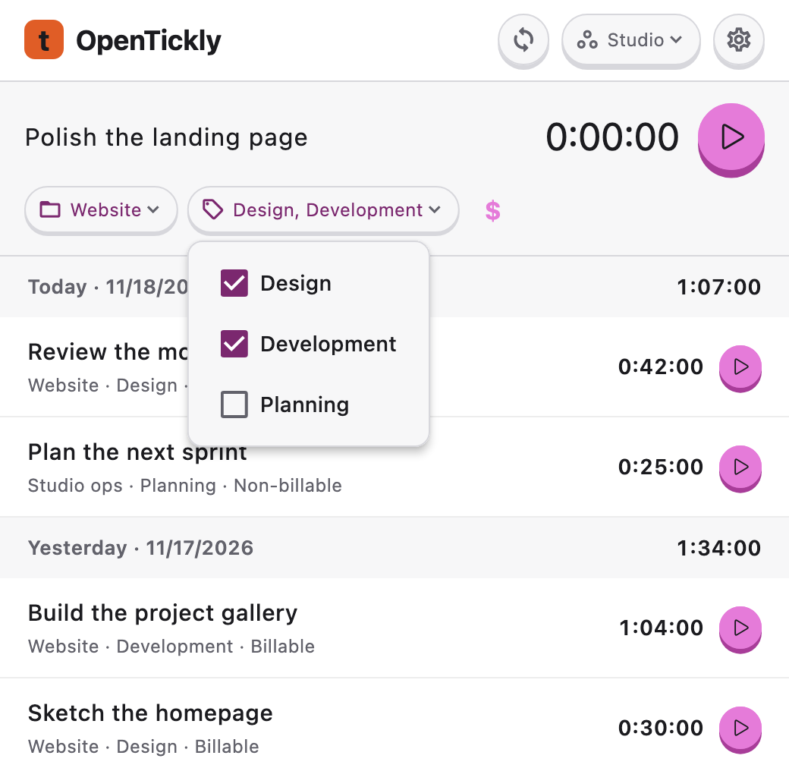

# OpenTickly for Mac

A free, independent macOS client for [OpenTickly](https://github.com/CorrectRoadH/OpenTickly). Start a timer from a compact window, glance at the elapsed time in your menu bar or Dock, and pick up a previous task with one click. Entries sync to your own OpenTickly installation.

<p>
  
  
</p>

## Track time

- Choose a project, click any tags you want, and use the **$** button to mark the entry as billable. The app remembers these choices and your workspace for the next session.
- Click **Play** beside a previous entry to start a new session with its description, project, tags, and billing setting.
- If you belong to multiple workspaces, switch between them in the header. The log shows your own entries and daily totals for the selected workspace.
- Entries and the running timer refresh every 30 seconds. Click **Sync all** to also refresh workspaces, projects, and tags.

## Connect your account

1. In the OpenTickly web app, open **Profile → API Token** and copy your token.
2. Open the Mac app, enter the HTTPS URL of your OpenTickly installation and paste the token into **API key**.
3. Click **Connect**. The app saves your connection in the macOS Keychain.

The interface follows your Mac’s preferred language and supports English and German. You can also choose a language in **Settings**.

## Run from source

The Mac client is currently available as source. On a Mac with Xcode and Flutter installed, use a Flutter SDK that includes Dart 3.13.4 or a compatible newer 3.x version.

```sh
git clone https://github.com/flowdee/opentickly-app.git
cd opentickly-app
flutter pub get
flutter run -d macos
```

The Xcode project uses fdmedia’s development team for signing. For a local build on another team, open `macos/Runner.xcworkspace` in Xcode and select your team for the **Runner** target under **Signing & Capabilities**. Run the widget tests with `flutter test`.

## Credits

Thanks to **CorrectRoadH and the OpenTickly contributors** for building the self-hosted time tracker and the API that makes this client possible. Visit the [OpenTickly project](https://github.com/CorrectRoadH/OpenTickly) or read the [self-hosting guide](https://opentoggl.com/docs/self-hosting).

I’m Florian (flowdee), the developer of this Mac client. [Follow me on X (Twitter)](https://x.com/flowdee) or [explore my blog and projects](https://flowdee.dev/).
